<!--
  Theme-aware README
  ------------------
  Every visual is wrapped in <picture> so GitHub serves the matching asset for
  the viewer's theme (prefers-color-scheme: dark / light). The original dark
  assets are unchanged; the light copies (*-light.svg / *-light.png) are
  produced by scripts/make_light_variants.py and refreshed by the
  "Update light-mode variants" workflow.
-->

<p align="center">
  <picture>
    <source media="(prefers-color-scheme: dark)" srcset="https://raw.githubusercontent.com/Loganth766/Loganth766/main/loganth-chromatic.svg" />
    <source media="(prefers-color-scheme: light)" srcset="https://raw.githubusercontent.com/LoganthP/LoganthP/main/loganth-chromatic-light.svg" />
    
  </picture>
</p>

<p align="center">
  <picture>
    <source media="(prefers-color-scheme: dark)" srcset="https://readme-typing-svg.herokuapp.com?color=00F7FF&size=26&center=true&vCenter=true&width=700&lines=Cybersecurity+%7C+AI+%7C+Full+Stack;Building+Secure+Intelligent+Systems" />
    <source media="(prefers-color-scheme: light)" srcset="https://readme-typing-svg.herokuapp.com?color=0E7490&size=26&center=true&vCenter=true&width=700&lines=Cybersecurity+%7C+AI+%7C+Full+Stack;Building+Secure+Intelligent+Systems" />
    
  </picture>
</p>

<p align="center">
  <picture>
    <source media="(prefers-color-scheme: dark)" srcset="https://raw.githubusercontent.com/LoganthP/LoganthP/main/loganthp-neofetch.svg?v=2" />
    <source media="(prefers-color-scheme: light)" srcset="https://raw.githubusercontent.com/LoganthP/LoganthP/main/loganthp-neofetch-light.svg?v=2" />
    
  </picture>
</p>

<p align="center">
  <a href="mailto:loganthp55@gmail.com"><picture><source media="(prefers-color-scheme: dark)" srcset="https://img.shields.io/badge/loganthp55%40gmail.com-0A0F1C?style=for-the-badge&logo=gmail&logoColor=00F7FF" /><source media="(prefers-color-scheme: light)" srcset="https://img.shields.io/badge/loganthp55%40gmail.com-E6F7FB?style=for-the-badge&logo=gmail&logoColor=0E7490" /></picture></a>
  <a href="tel:+917013660227"><picture><source media="(prefers-color-scheme: dark)" srcset="https://img.shields.io/badge/%2B91%2070136%2060227-0A0F1C?style=for-the-badge" /><source media="(prefers-color-scheme: light)" srcset="https://img.shields.io/badge/%2B91%2070136%2060227-E6F7FB?style=for-the-badge" /></picture></a>
</p>

<details>
<summary>View as text</summary>

```text
loganth@github:~$ neofetch

loganth@github
--------------
OS:       B.E. CSE @ VVCE, Mysuru
Host:     Radar Engineering Intern @ LRDE–DRDO
Kernel:   Cybersecurity · AI · Full Stack
Uptime:   2023 → Present

Packages: Python · C/C++ · Java · React · Node.js
Cloud:    AWS · GCP · Docker · Kubernetes
Shell:    Git · Linux · Postman · n8n
AI:       RAG · LangChain · FAISS · ChromaDB

Awards:   3rd place · GLYTCH National Hackathon
Status:   Building secure, intelligent systems

Email:    loganthp55@gmail.com
Phone:    +91 70136 60227
```

</details>

---

## 🚀 What I Do


```bash
> Building AI-powered intelligent applications

> Developing scalable full-stack platforms

> Designing secure systems & cybersecurity tools

> Solving real-world engineering problems
```

<p align="left">
<picture>
  <source media="(prefers-color-scheme: dark)" srcset="https://img.shields.io/badge/Cybersecurity-050816?style=for-the-badge&logo=hackthebox&logoColor=00F7FF" />
  <source media="(prefers-color-scheme: light)" srcset="https://img.shields.io/badge/Cybersecurity-E6F7FB?style=for-the-badge&logo=hackthebox&logoColor=0E7490" />
  
</picture>
<picture>
  <source media="(prefers-color-scheme: dark)" srcset="https://img.shields.io/badge/Artificial%20Intelligence-050816?style=for-the-badge&logo=openai&logoColor=00F7FF" />
  <source media="(prefers-color-scheme: light)" srcset="https://img.shields.io/badge/Artificial%20Intelligence-E6F7FB?style=for-the-badge&logo=openai&logoColor=0E7490" />
  
</picture>
<br><br>
<picture>
  <source media="(prefers-color-scheme: dark)" srcset="https://img.shields.io/badge/Full%20Stack-050816?style=for-the-badge&logo=vercel&logoColor=00F7FF" />
  <source media="(prefers-color-scheme: light)" srcset="https://img.shields.io/badge/Full%20Stack-E6F7FB?style=for-the-badge&logo=vercel&logoColor=0E7490" />
  
</picture>
<picture>
  <source media="(prefers-color-scheme: dark)" srcset="https://img.shields.io/badge/Problem%20Solving-050816?style=for-the-badge&logo=codeforces&logoColor=00F7FF" />
  <source media="(prefers-color-scheme: light)" srcset="https://img.shields.io/badge/Problem%20Solving-E6F7FB?style=for-the-badge&logo=codeforces&logoColor=0E7490" />
  
</picture>
</p>

---

## 🧰 Tech Stack

### 💻 Programming Languages

<p align="center">
  
</p>

### 🌐 Web Technologies

<p align="center">
  
</p>

### 🗄️ Databases & Cloud

<p align="center">
  
</p>

### ⚙️ Tools & Platforms

<p align="center">
  
  
</p>

### 🤖 AI & RAG

<p align="center">
  
  
  
  
</p>

---

## 📡 Live Activity

<picture>
  <source
    media="(prefers-color-scheme: dark)"
    srcset="https://raw.githubusercontent.com/LoganthP/PixelSerpent/output/github-contribution-grid-snake-dark.svg">

  <source
    media="(prefers-color-scheme: light)"
    srcset="https://raw.githubusercontent.com/LoganthP/PixelSerpent/output/github-contribution-grid-snake.svg">

  
</picture>

<p align="center">
  <picture>
    <source media="(prefers-color-scheme: dark)" srcset="https://raw.githubusercontent.com/LoganthP/JetCommit/main/dist/github-jet.svg" />
    <source media="(prefers-color-scheme: light)" srcset="https://raw.githubusercontent.com/LoganthP/LoganthP/main/jetcommit-light.svg" />
    
  </picture>
</p>

---

## 🌐 Connect • Network • Explore

<p align="center">
  <a href="https://www.linkedin.com/in/loganth-p-158667280/" target="_blank"><picture><source media="(prefers-color-scheme: dark)" srcset="https://img.shields.io/badge/LinkedIn-0A0F1C?style=for-the-badge&logo=linkedin&logoColor=00F7FF" /><source media="(prefers-color-scheme: light)" srcset="https://img.shields.io/badge/LinkedIn-E6F7FB?style=for-the-badge&logo=linkedin&logoColor=0E7490" /></picture></a>
  <a href="https://leetcode.com/u/loganthp-1910/" target="_blank"><picture><source media="(prefers-color-scheme: dark)" srcset="https://img.shields.io/badge/LeetCode-0A0F1C?style=for-the-badge&logo=leetcode&logoColor=00F7FF" /><source media="(prefers-color-scheme: light)" srcset="https://img.shields.io/badge/LeetCode-E6F7FB?style=for-the-badge&logo=leetcode&logoColor=0E7490" /></picture></a>
  <a href="https://www.hackerrank.com/profile/loganth_1925" target="_blank"><picture><source media="(prefers-color-scheme: dark)" srcset="https://img.shields.io/badge/HackerRank-0A0F1C?style=for-the-badge&logo=hackerrank&logoColor=00F7FF" /><source media="(prefers-color-scheme: light)" srcset="https://img.shields.io/badge/HackerRank-E6F7FB?style=for-the-badge&logo=hackerrank&logoColor=0E7490" /></picture></a>
  <a href="mailto:loganthp19@gmail.com"><picture><source media="(prefers-color-scheme: dark)" srcset="https://img.shields.io/badge/Email-0A0F1C?style=for-the-badge&logo=gmail&logoColor=00F7FF" /><source media="(prefers-color-scheme: light)" srcset="https://img.shields.io/badge/Email-E6F7FB?style=for-the-badge&logo=gmail&logoColor=0E7490" /></picture></a>
</p>

<p align="center">
  <picture>
    <source media="(prefers-color-scheme: dark)" srcset="https://raw.githubusercontent.com/Loganth766/Loganth766/main/assets/footer.svg" />
    <source media="(prefers-color-scheme: light)" srcset="https://raw.githubusercontent.com/LoganthP/LoganthP/main/assets/footer-light.svg" />
    
  </picture>
</p>
